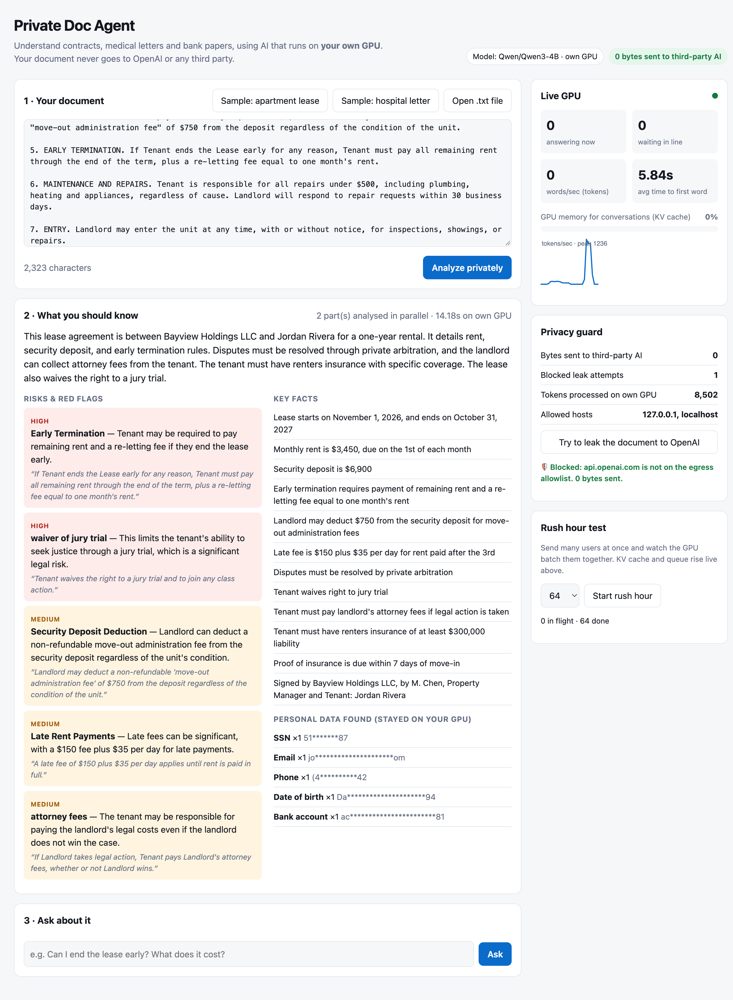
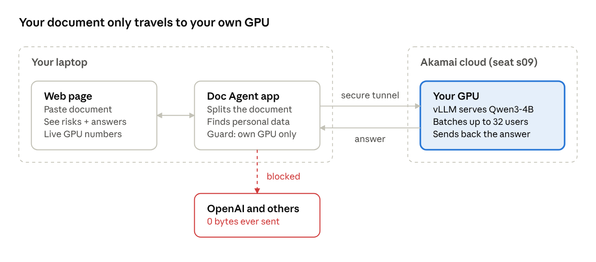

# Private Doc Agent

**An AI agent that reads your most private documents (leases, hospital discharge letters, bank papers) and explains them in plain English, running entirely on a GPU you control.** No OpenAI, no per-token bill, no customer data leaving your infrastructure.

Built for *Build AI agents that own their inference* (#SFTechWeek, Akamai, Oct 12 2026) on the workshop's dedicated GPU: **Qwen/Qwen3-4B served by vLLM on Akamai (Linode LKE).**

**▶ Demo video (2 min):** [video/demo.mp4](video/demo.mp4)





## What it does

1. **Analyze privately.** It splits the document into parts and sends **all parts to the GPU at once**, so vLLM batches them together (continuous batching). Then it merges them into:
   - a plain-English summary
   - **risks and red flags**, ranked high, medium or low, each with the exact quote from the document
   - key facts (dates, amounts, deadlines)
2. **Ask about it.** Grounded Q&A that picks the relevant excerpts, answers only from them and cites a source quote.
3. **Personal data detector.** Finds SSNs, emails, phones, DOBs, MRNs and bank accounts on the laptop and shows them masked, to show what *would* have leaked to a hosted API.
4. **Egress guard.** Every outbound call goes through one function that refuses any host outside the allowlist (`localhost`) **before any I/O**. The "Try to leak to OpenAI" button proves it live: *Blocked, 0 bytes sent.*
5. **Live GPU panel.** Reads vLLM's `/metrics`: requests running and waiting, KV-cache usage, tokens/sec (sparkline) and time to first token.
6. **Rush hour test.** Fires 16 to 128 concurrent users so you can watch batching, queueing and KV-cache pressure happen.

## Results on the workshop GPU (measured today)

| Test | Result |
|---|---|
| Lease analysis (2 parts in parallel) | ~14 s, 5 ranked risks with quotes, 5 PII items detected |
| Grounded Q&A ("Can I end the lease early?") | 2.3 s, correct answer with source quote |
| Rush hour, 64 concurrent users | **32 running + 32 waiting**: the server caps concurrent sequences at 32, and the rest queue |
| Throughput under load | **~1,236 tokens/s peak** |
| Requests failed under load | 0 / 64 |
| Bytes sent to third-party AI | **0** (leak attempt to api.openai.com blocked before I/O) |

**What we learned about inference:** batching 32 users at once pushed throughput to ~1,200 tokens/s while KV-cache use stayed under 7%. So for short requests, the bottleneck on this deployment is the **max concurrent sequences setting (32)**, not GPU memory. Extra users simply wait in line. Raising `--max-num-seqs` is the next optimization to try.

## Run it

Requires Python 3.9+ (standard library only, no `pip install`) and `kubectl`.

```bash
./start.sh                 # opens the GPU tunnel if needed, then serves http://localhost:5050
python3 -m unittest -v     # 12 unit tests (no GPU needed)
```

Config via environment variables: `VLLM_BASE_URL` (default `http://localhost:8000`), `VLLM_MODEL`, `EGRESS_ALLOWLIST`, `PORT`, `KUBECONFIG_FILE`.

## How it's built

```
app/llm.py      OpenAI-compatible client for our own vLLM + egress guard + usage counters
app/agent.py    chunking, parallel analysis, merge, keyword retrieval, grounded Q&A
app/metrics.py  vLLM Prometheus /metrics -> live snapshot (tokens/s, KV cache, queue, TTFT)
app/privacy.py  local PII/PHI detection and masking
app/server.py   stdlib HTTP server + JSON API
static/         single-page UI (no frameworks)
samples/        synthetic lease and hospital discharge letter (no real people)
```

Qwen3 "thinking" is turned off (`enable_thinking: false`) to cut latency and tokens. JSON mode is used for structured risk extraction.
